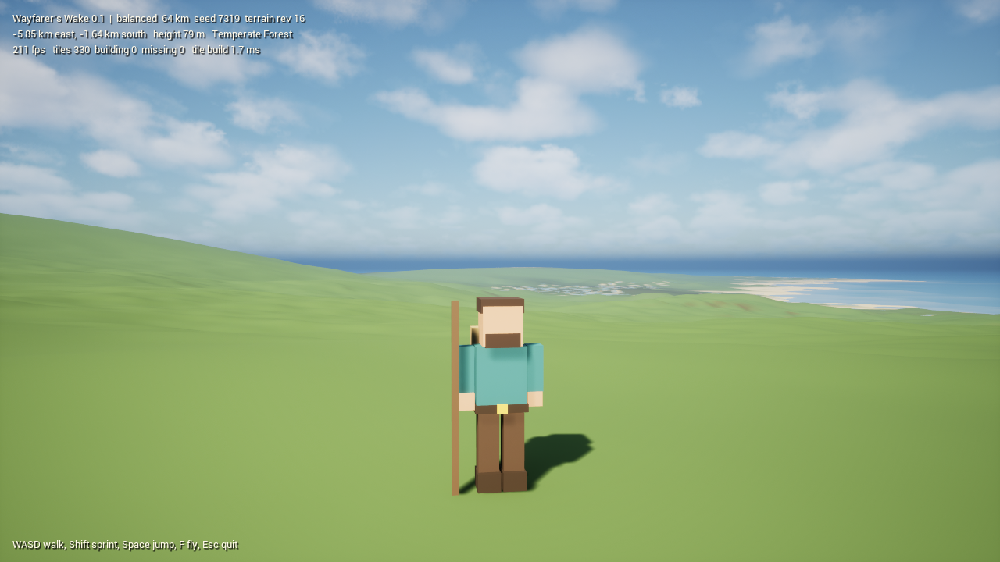

# Wayfarer's Wake

A procedural fantasy survival sandbox: a world to live in. This is the Unreal Engine 5.9 reimplementation of the Godot project Thornwake, keeping its deterministic world generator.

* **Where things stand:** [MIGRATION_STATUS.md](MIGRATION_STATUS.md)
* **What was ported and what was not:** [SYSTEM_AUDIT.md](SYSTEM_AUDIT.md)
* **Why it is built this way:** [DECISIONS.md](DECISIONS.md)
* **Measurements:** [BENCHMARK.md](BENCHMARK.md)
* **Devlog site:** [docs/index.html](docs/index.html)
* **Original brief:** [docs/readme.md](docs/readme.md)

